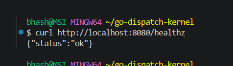
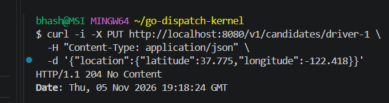
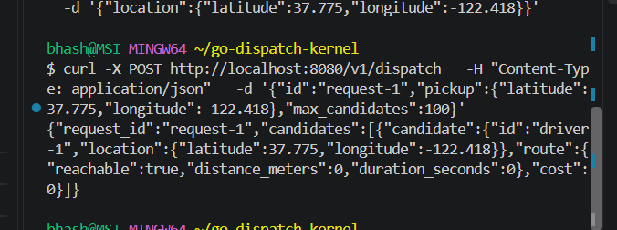

# Dispatch Kernel

A Go starter implementation for a modular dispatch pipeline. It combines an
H3-backed candidate index with batched Valhalla matrix routing and an injectable
scoring policy. It is an initial service foundation, not a claim that the
100k-concurrent-operation or sub-millisecond targets have been benchmarked.

## Run on Windows with Git Bash

Requires Go 1.25+, Docker Desktop with its Linux engine running, and enough
memory and disk space to build Valhalla's routing tiles. These commands use the
California OpenStreetMap extract, which is a large download and tile build.

### 1. Start Valhalla

Create a persistent Docker volume and start Valhalla:

```bash
docker volume create valhalla-data
docker run -d --name valhalla -p 8002:8002 \
  -v valhalla-data:/custom_files \
  -e tile_urls=https://download.geofabrik.de/north-america/us/california-latest.osm.pbf \
  ghcr.io/nilsnolde/docker-valhalla/valhalla:latest
```

Follow the initial download and tile build:

```bash
docker logs -f valhalla
```

Press `Ctrl+C` to stop following logs; this does not stop the container. The
first build can take a long time and use several GB of RAM and disk. Keep
Docker Desktop running. Wait until Valhalla is serving before continuing:

```bash
curl -i http://localhost:8002/status
```

Expect `HTTP/1.1 200 OK`. Verify that Valhalla can find a road near the sample
pickup before trying dispatch:

```bash
curl -G http://localhost:8002/locate \
  --data-urlencode 'json={"verbose":false,"locations":[{"lat":37.775,"lon":-122.418}],"costing":"auto"}'
```

The response should contain an `edges` array. If it is `null` or empty, the
tiles may be incomplete; check `docker logs --tail 50 valhalla`. If the tile
builder was killed for running out of memory, increase Docker's available
memory and rebuild the tiles before using the API. On a 16 GB Windows PC, the
California build may require increasing WSL memory (for example, in
`%USERPROFILE%\.wslconfig`):

```ini
[wsl2]
memory=10GB
```

After changing `.wslconfig`, run `wsl --shutdown` in PowerShell, reopen Docker
Desktop, and rebuild. To rebuild incomplete tiles while preserving the map
download, remove and recreate only the container:

```bash
docker stop valhalla
docker rm valhalla
docker run -d --name valhalla -p 8002:8002 \
  -v valhalla-data:/custom_files \
  -e tile_urls=https://download.geofabrik.de/north-america/us/california-latest.osm.pbf \
  -e force_rebuild=True \
  ghcr.io/nilsnolde/docker-valhalla/valhalla:latest
```

Do not remove the `valhalla-data` volume unless you intend to delete the
downloaded map and tile data.

### 2. Start the Go API

In a second Git Bash window, from the project directory:

```bash
export VALHALLA_URL="http://localhost:8002"
go run ./cmd/dispatchd
```

Leave this window open. REST listens on port 8080 and gRPC listens on
`127.0.0.1:9090` by default. Check REST from another terminal:

```bash
curl http://localhost:8080/healthz
```



Expected response: `{"status":"ok"}`.

Candidate records are persisted to `candidates.db` by default, so they survive
Go API restarts. Set `CANDIDATE_DB_PATH` to choose another file. Back up this
file before removing or replacing it.

### 3. Use the REST API

REST is the HTTP/JSON interface on port `8080`. Register or move a candidate:

```bash
curl -i -X PUT http://localhost:8080/v1/candidates/driver-1 \
  -H "Content-Type: application/json" \
  -d '{"location":{"latitude":37.775,"longitude":-122.418}}'
```



Request dispatch:

```bash
curl -X POST http://localhost:8080/v1/dispatch \
  -H "Content-Type: application/json" \
  -d '{"id":"request-1","pickup":{"latitude":37.775,"longitude":-122.418},"max_candidates":100}'
```


REST dispatch returns JSON with the ranked candidates.

### 4. Use the gRPC API

gRPC is a second interface to the same Go service, listening on
`127.0.0.1:9090` by default. REST and gRPC use the same dispatch engine and
`candidates.db`, so candidates registered through either interface are
available to the other.

Install `grpcurl` if needed:

```bash
go install github.com/fullstorydev/grpcurl/cmd/grpcurl@latest
export PATH="$(cygpath -u "$(go env GOPATH)")/bin:$PATH"
```

Register a candidate through gRPC:

```bash
grpcurl -plaintext -import-path api/proto \
  -proto dispatch/v1/dispatch.proto \
  -d '{"candidate":{"id":"grpc-driver","location":{"latitude":37.775,"longitude":-122.418}}}' \
  127.0.0.1:9090 dispatch.v1.DispatchService/UpsertCandidate
```

An empty `{}` response is expected for `UpsertCandidate`; the RPC succeeded.
Dispatch over gRPC:

```bash
grpcurl -plaintext -import-path api/proto \
  -proto dispatch/v1/dispatch.proto \
  -d '{"id":"grpc-request-1","pickup":{"latitude":37.775,"longitude":-122.418},"maxCandidates":100}' \
  127.0.0.1:9090 dispatch.v1.DispatchService/Dispatch
```
The grpc curl response :
{
  "requestId": "grpc-request-1",
  "candidates": [
    {
      "candidate": {
        "id": "driver-1",
        "location": {
          "latitude": 37.775,
          "longitude": -122.418
        }
      },
      "route": {
        "reachable": true
      }
    },
    {
      "candidate": {
        "id": "grpc-driver",
        "location": {
          "latitude": 37.775,
          "longitude": -122.418
        }
      },
      "route": {
        "reachable": true
      }
    }
  ]
}


`grpcurl` uses protobuf JSON field names, so `max_candidates` is written as
`maxCandidates`. It may omit fields with default values (for example,
zero-valued distance or duration). To delete a candidate through gRPC:

```bash
grpcurl -plaintext -import-path api/proto \
  -proto dispatch/v1/dispatch.proto \
  -d '{"id":"grpc-driver"}' \
  127.0.0.1:9090 dispatch.v1.DispatchService/DeleteCandidate
```

The REST API offers the same operations on port `8080`; use either interface
or both. The gRPC listener binds to loopback by default. Configure TLS and
authentication before exposing it beyond localhost.

The response includes the ranked candidates and route metrics. When pickup and
candidate coordinates are identical, a zero distance and duration are
expected. The default bbolt database persists candidate records across Go API
restarts.

To stop Valhalla, run `docker stop valhalla`. Start it again with
`docker start valhalla`; the downloaded map and built tiles remain in the
`valhalla-data` volume.

### Configuration

| Variable | Default | Description |
| --- | --- | --- |
| `HTTP_ADDR` | `:8080` | HTTP listen address |
| `VALHALLA_URL` | required | Base URL for the Valhalla service |
| `VALHALLA_COSTING` | `auto` | Valhalla costing model |
| `H3_RESOLUTION` | `9` | H3 index resolution (0-15) |
| `H3_RADIUS_CELLS` | `2` | H3 grid distance to search (0-20) |
| `CANDIDATE_DB_PATH` | `candidates.db` | Persistent bbolt candidate database |
| `GRPC_ADDR` | `127.0.0.1:9090` | gRPC listen address |
| `SCORING_MODE` | `duration` | `duration` or `fare` scoring |
| `FARE_BASE` | `0` | Base fare when `SCORING_MODE=fare` |
| `FARE_SERVICE_FEE` | `0` | Service fee when `SCORING_MODE=fare` |
| `FARE_PER_KILOMETER` | `0` | Fare rate per kilometer |
| `FARE_PER_MINUTE` | `0` | Fare rate per minute |
| `GEOFENCE_POLYGON` | unset | Optional JSON array of `{latitude,longitude}` vertices |
| `PPROF_ADDR` | disabled | Optional loopback-only Go pprof listener |

Example optional fare and service-area configuration in Git Bash:

```bash
export SCORING_MODE=fare
export FARE_BASE=2
export FARE_SERVICE_FEE=1
export FARE_PER_KILOMETER=1.5
export FARE_PER_MINUTE=0.6
export GEOFENCE_POLYGON='[{"latitude":37.70,"longitude":-122.52},{"latitude":37.70,"longitude":-122.35},{"latitude":37.83,"longitude":-122.35},{"latitude":37.83,"longitude":-122.52}]'
```

Fare values use the same units; the scorer ranks lower fares first. The
geofence requires both pickup and candidate locations to be inside the
configured polygon. These are sample mechanisms, not production pricing or
service-area policies.

The protobuf contract is in `api/proto/dispatch/v1/dispatch.proto`; generated
Go bindings are in `gen/dispatch/v1`. The gRPC listener binds to loopback by
default. Before exposing it beyond localhost, configure transport security
and authentication. `DispatchService` provides `UpsertCandidate`,
`DeleteCandidate`, and `Dispatch`.

## API

Register or move a candidate:

```http
PUT /v1/candidates/{id}
Content-Type: application/json

{"location":{"latitude":37.775,"longitude":-122.418}}
```

Dispatch candidates near a pickup point:

```http
POST /v1/dispatch
Content-Type: application/json

{"id":"request-123","pickup":{"latitude":37.775,"longitude":-122.418},"max_candidates":100}
```

The candidate limit defaults to 100 and is capped at 500. The kernel queries
H3 cells, routes the resulting destinations in one Valhalla matrix request,
omits unreachable candidates, and sorts the rest by the injected scorer's
ascending cost. `DELETE /v1/candidates/{id}` removes a candidate; `GET /healthz`
is a liveness check.

## Extension points

`kernel.CandidateSource`, `kernel.Router`, `kernel.Scorer`, and `kernel.Matcher`
are internal Go interfaces. The default candidate store is a bbolt-backed H3
index; the default scorer orders by duration. Optional polygon geofencing and
fare scoring are configurable at startup. The H3 implementation uses a
pure-Go H3 library so the project also builds on Windows without cgo.

The benchmark suite includes H3 lookup and dispatch-pipeline benchmarks. It
does not simulate Valhalla latency or prove the 100k-concurrency/sub-millisecond
targets. Production use still needs authentication/authorization, observability,
and deployment-specific capacity testing.

## Validate

```bash
go test ./...
go vet ./...
go test ./internal/kernel ./internal/spatial -run '^$' \
  -bench 'BenchmarkDispatchPipeline|BenchmarkH3IndexSearchParallel' \
  -benchmem -cpu=1,2,4,8
```
Unit Testcase Result :


Benchmarkdispatch Result :

goos: windows
goarch: amd64
pkg: dispatchkernel/internal/kernel
cpu: AMD Ryzen 5 7535HS with Radeon Graphics        
BenchmarkDispatchPipeline           5328            220830 ns/op           30056 B/op         18 allocs/op
BenchmarkDispatchPipeline-2        10000            105374 ns/op           30056 B/op         18 allocs/op
BenchmarkDispatchPipeline-4        21306             55942 ns/op           30056 B/op         18 allocs/op
BenchmarkDispatchPipeline-8        26968             43376 ns/op           30056 B/op         18 allocs/op
PASS
ok      dispatchkernel/internal/kernel  6.503s
goos: windows
goarch: amd64
pkg: dispatchkernel/internal/spatial
cpu: AMD Ryzen 5 7535HS with Radeon Graphics        
BenchmarkH3IndexSearchParallel              5540            231763 ns/op           11960 B/op          8 allocs/op
BenchmarkH3IndexSearchParallel-2           10000            115975 ns/op           11960 B/op          8 allocs/op
BenchmarkH3IndexSearchParallel-4           19882             57315 ns/op           11960 B/op          8 allocs/op
BenchmarkH3IndexSearchParallel-8           34312             34585 ns/op           11960 B/op          8 allocs/op
PASS
ok      dispatchkernel/internal/spatial 6.062s


On the development PC (AMD Ryzen 5 7535HS, Go 1.26, Windows), a one-second
benchmark run measured about **221 µs/op** for the in-memory dispatch pipeline
at `-cpu=1` and **46 µs/op** at `-cpu=8`. Parallel H3 lookup measured about
**228 µs/op** at `-cpu=1` and **34 µs/op** at `-cpu=8`. These microbenchmarks
use a fake, in-process router and do not include HTTP, network, Valhalla, or
bbolt writes; they are not end-to-end latency results.

Run the opt-in simultaneous-dispatch stress check (uses 100,000 goroutines):

```bash
DISPATCH_STRESS_CONCURRENCY=100000 go test ./internal/kernel \
  -run '^TestDispatchStress$' -count=1 -timeout=3m
```

On the same development PC, 100,000 concurrent in-process dispatches completed
in about **678 ms** with no failures. This verifies that stress-test scenario,
not 100,000 sustained network requests or a production capacity guarantee.

For runtime CPU and heap profiles, start the API with a loopback pprof listener:

```bash
export PPROF_ADDR=127.0.0.1:6060
go run ./cmd/dispatchd
```

In another terminal, capture profiles with `go tool pprof`:

```bash
go tool pprof http://localhost:6060/debug/pprof/profile?seconds=30
go tool pprof http://localhost:6060/debug/pprof/heap
```

The race detector requires cgo and a C compiler on Windows; run
`go test -race ./...` where those are available.
